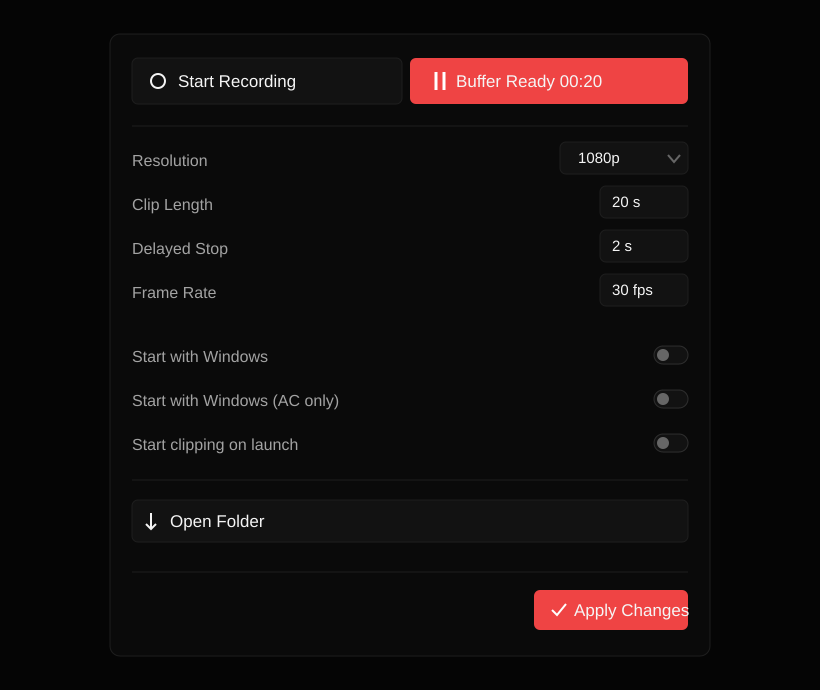

# Cliffy

Cliffy is a small Windows tool that saves the last few seconds of your screen as a video clip. I made it because NVIDIA's clip recording was not working on my PC.



## How it works

Cliffy keeps a short video buffer in memory. When you save a clip, it waits for the extra time you choose, then saves the earlier part and the new few seconds together. With the defaults, that is 20 seconds before the save request and 2 seconds after it.

The clip is saved as an H.264 MP4 in `D:\Videos\Cliffy`. Video is already encoded in the buffer, so saving does not encode it a second time. Clip names include the extra time, for example `Clip_<timestamp>_extra2sec.mp4`.

## Default settings

- 1080p at 30 FPS
- 20 seconds of replay and 2 seconds of extra recording
- Clip sound on
- Start in the system tray

You can change the replay length from 5 to 120 seconds and the extra recording time from 0 to 60 seconds. Settings apply while Cliffy is open and are not saved to a config file.

Left-click the tray icon or press **Alt+Shift+S** to open the settings. Closing the window hides Cliffy in the tray. Choose **Quit Cliffy** in the tray menu to exit.

## Requirements

Cliffy runs on Windows and needs either an NVIDIA GPU with NVENC or an Intel GPU with Quick Sync H.264 encoding. When both are available, it tries NVIDIA first. If that encoder cannot start, Cliffy restarts capture on Intel Quick Sync. It keeps capture and encoding on the same GPU to avoid copying every frame between adapters. Windows Graphics Capture and Media Foundation must also be available.

## Build

Install Rust, open a terminal in this folder, and run:

```powershell
cargo build --release
```

See [CHANGELOG.md](CHANGELOG.md) for the project notes. Local test videos and diagnostic logs are not included.
